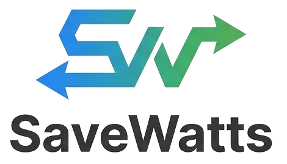

<p align="center">
  
</p>

# SaveWatts · sitio de presentación

Página web estática (HTML, CSS y JavaScript, sin dependencias) para presentar el proyecto **SaveWatts** en exposiciones y ferias: 8 pantallas, un semáforo interactivo y capturas reales de la app.

- **Sitio publicado:** https://savewatts-sitio.vercel.app
- **App en internet:** https://savewatts.onrender.com
- **Código de la app y documentación de entrega:** repositorio `SaveWatts` (carpeta `docs/`)

## Cómo se usa

- Flechas ← → o Av Pág / Re Pág: cambiar de pantalla. **F**: pantalla completa.
- Al cargar, el sitio despierta la app (el plan gratuito de Render se duerme tras 15 minutos sin uso).

## Probarlo en el computador

```bash
python -m http.server 5173     # o: npx serve
```

Abre http://localhost:5173.

## Publicarlo en Vercel

Importa este repositorio en Vercel (**Add New → Project**), con **Framework Preset: Other** y sin comandos de build. `vercel.json` ya trae las cabeceras de seguridad.

## Qué contiene

| Archivo | Para qué |
|---|---|
| `index.html` | Las 8 pantallas |
| `styles.css` | Estilos con la identidad de SaveWatts (Inter, azul, verde, gris, papel) |
| `app.js` | Semáforo interactivo, navegación por teclado y despertar la app |
| `vercel.json` | Política de seguridad de contenido y caché |
| `img/`, `fonts/` | Logo, capturas de la app e Inter |

El semáforo interactivo usa las mismas reglas del servidor: verde por debajo de 70 %, amarillo de 70 a 100 %, rojo por encima de 100 %.

> Este repositorio es una copia de la carpeta `sitio/` del proyecto principal. Si se cambia allá, hay que copiar los cambios aquí.
